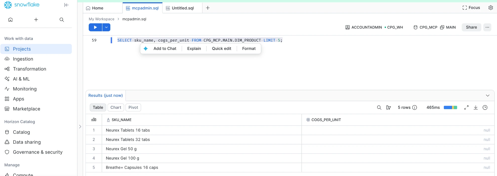
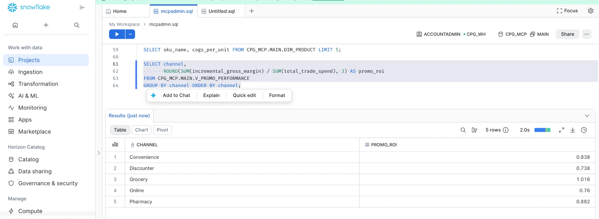

# mcp-warehouse-adapters

[](https://github.com/sachingill/mcp-warehouse-adapters/actions/workflows/ci.yml)

Run [cpg-analytics-mcp](https://github.com/sachingill/cpg-analytics-mcp), a governed MCP server for CPG
commercial analytics, on **Snowflake** or **Databricks** instead of DuckDB.

## Why this exists

Enterprises won't copy their data into a local database. An AI analytics server has to run on *their* platform
and respect *their* permissions. So governance is pushed **down** to the platform:

| Concern | Server (first line) | Snowflake (second line) |
|---|---|---|
| Who reads which tables | `roles.yaml` table allowlists | `SELECT` grants generated from the same `roles.yaml` |
| Unit cost (`cogs_per_unit`) | Blocked column in the SQL guardrails | **Masking policy**: `NULL` for analyst and sales roles |
| Promo ROI still available to analysts | Governed metric | Views owned by the loader role compute with cost (`INVOKER_ROLE()`) |
| Writes | Guardrails allow one `SELECT` only | Read-only roles have no write privileges |
| Accountability | JSONL audit log | `QUERY_TAG` on every statement (`mcp_role` included) |
| Runaway queries | Row cap | `STATEMENT_TIMEOUT_IN_SECONDS` + resource monitor credit cap |

If a guardrail had a bug, Snowflake would still refuse.

## Proof: running on Snowflake

Screenshots from Snowsight on a trial account, after `mwa-snowflake-load`.

**Unit cost is masked by Snowflake itself.** `cogs_per_unit` returns `null`, even for `ACCOUNTADMIN`: the masking
policy generated from `roles.yaml` only reveals cost to `CPG_FINANCE` (and the loader that owns the views).



**The governed ROI metric still works.** The view is owned by the loader role, so inside it the masking policy sees
`INVOKER_ROLE() = 'CPG_LOADER'` and margin is computed from real cost. The numbers match the DuckDB build exactly.



Same question through the MCP server, as the analyst role, on all three warehouses
(`get_metric` → `promo_roi` / `range_roi` by channel):

| Channel | DuckDB | Snowflake | Databricks |
|---|---|---|---|
| Convenience | 0.838 / 0.771 | 0.838 / 0.771 | 0.838 / 0.771 |
| Discounter | 0.738 / 0.665 | 0.738 / 0.665 | 0.738 / 0.665 |
| Grocery | 1.016 / 0.970 | 1.016 / 0.970 | 1.016 / 0.970 |
| Online | 0.760 / 0.744 | 0.760 / 0.744 | 0.760 / 0.744 |
| Pharmacy | 0.882 / 0.788 | 0.882 / 0.788 | 0.882 / 0.788 |

Full test run with both platforms live: **48 passed**. Each platform runs the shared warehouse contract plus its own
governance tests (cost hidden for analysts, governed ROI intact, finance sees cost, sales blocked, read-only
identities; Snowflake secondary roles off; Databricks raw layer unreadable by every service principal).

## How it plugs in

The server talks to any warehouse through a two-method interface (`catalog()`, `query()`). This package registers
`snowflake` under the `cpg_analytics_mcp.warehouses` entry point, so `CPG_MCP_WAREHOUSE=snowflake` is all the
server needs. Governed SQL is written once in DuckDB dialect and translated with sqlglot. Every adapter must pass
the same [contract tests](https://github.com/sachingill/cpg-analytics-mcp/blob/main/src/cpg_analytics_mcp/testing/warehouse_contract.py)
as DuckDB. See the [design note](https://github.com/sachingill/cpg-analytics-mcp/blob/main/docs/warehouse-adapters.md).

## Snowflake quickstart

Use a personal trial account and the synthetic data only.

1. **Key pair** for the service user (your passphrase stays with you):
   ```bash
   mkdir -p ~/.snowflake && chmod 700 ~/.snowflake
   openssl genrsa 2048 | openssl pkcs8 -topk8 -v2 aes-256-cbc -inform PEM -out ~/.snowflake/cpg_mcp_key.p8
   openssl rsa -in ~/.snowflake/cpg_mcp_key.p8 -pubout -out ~/.snowflake/cpg_mcp_key.pub
   chmod 600 ~/.snowflake/cpg_mcp_key.p8
   ```
2. **Environment** (in your shell profile, never in the repo):
   ```bash
   export SNOWFLAKE_ACCOUNT=<orgname-accountname>
   export SNOWFLAKE_ADMIN_USER=<your Snowsight login>        # setup only
   export SNOWFLAKE_PUBLIC_KEY_PATH=~/.snowflake/cpg_mcp_key.pub
   export SNOWFLAKE_USER=CPG_MCP_SVC
   export SNOWFLAKE_PRIVATE_KEY_PATH=~/.snowflake/cpg_mcp_key.p8
   export SNOWFLAKE_PRIVATE_KEY_PASSPHRASE=...   # or leave unset and use an unencrypted key
   ```
3. **Account setup**, once: runs [`setup.sql`](src/mcp_warehouse_adapters/snowflake/setup.sql) as `ACCOUNTADMIN`
   (browser login), filling the service user's public key from `SNOWFLAKE_PUBLIC_KEY_PATH` in memory. It creates
   an XS warehouse with a credit cap, the `CPG_MCP.MAIN` schema, one loader role plus one read-only role per
   server role, and a key-pair-only service user.
   ```bash
   uv sync
   uv run mwa-snowflake-setup
   ```
4. **Load, test, run:**
   ```bash
   uv run mwa-snowflake-load        # synthetic data -> Parquet -> COPY INTO; views; grants; masks
   uv run pytest -q                 # offline tests + live contract and governance tests
   CPG_MCP_WAREHOUSE=snowflake CPG_MCP_ROLE=analyst uv run cpg-analytics-mcp
   ```

The server role selects the Snowflake role (`analyst` → `CPG_ANALYST`), so the same question gets the same policy
from both lines of defense.

## Databricks quickstart

Use a personal Free Edition workspace and the synthetic data only.

Databricks has no `USE ROLE`: permissions follow the identity. So each server role logs in as its **own service
principal** (`cpg-mcp-analyst`, …) via OAuth machine-to-machine, and Unity Catalog enforces what `roles.yaml` says:

```
cpg_mcp.raw    base tables, real values, no grants to any service principal
cpg_mcp.main   dynamic views:  dim_product.cogs_per_unit = CASE WHEN is_member('cpg_finance') THEN … END
               analysis views: v_promo_performance reads raw.* with the owner's rights -> real ROI
```

Two platform findings shaped this design (both covered by tests):

- **Column masks apply inside views as the querying user.** With a mask on `cogs_per_unit`, an analyst's promo ROI
  through the view came back `NULL`. Snowflake has `INVOKER_ROLE()` for this; Unity Catalog does not. A protected
  raw layer plus dynamic views gives the same outcome: cost hidden, governed ROI intact.
- **Free Edition only has workspace-local groups**, and Unity Catalog cannot grant to them (`PRINCIPAL_DOES_NOT_EXIST`).
  Grants therefore go to the service principals; the views check `is_member(...)`. In a full account, use account
  groups and `is_account_group_member()`.

1. **Admin token** (in your shell profile, never in the repo): Settings → Developer → Access tokens.
   ```bash
   export DATABRICKS_HOST=https://<workspace>.cloud.databricks.com
   export DATABRICKS_TOKEN=...
   ```
2. **Identities**, once: creates one service principal and group per server role, grants SQL warehouse access, and
   writes each principal's OAuth secret to `~/.databricks/cpg_mcp.env` (mode 600, never printed).
   ```bash
   uv run mwa-databricks-setup              # --remove deletes them again
   ```
3. **Load, test, run:**
   ```bash
   uv run mwa-databricks-load               # Parquet -> UC Volume -> tables; views; column mask; grants
   uv run pytest -q
   CPG_MCP_WAREHOUSE=databricks CPG_MCP_ROLE=analyst uv run cpg-analytics-mcp
   ```

## Layout

```
src/mcp_warehouse_adapters/policy.py   roles.yaml -> allowed objects and hidden columns (shared by both)
src/mcp_warehouse_adapters/snowflake/
  setup.sql       one-time account setup; <PUBLIC_KEY> placeholder only
  setup.py        runs setup.sql as ACCOUNTADMIN, key read from SNOWFLAKE_PUBLIC_KEY_PATH
  config.py       env-based settings, key-pair loading, server role -> platform role
  warehouse.py    SnowflakeWarehouse: qmark binding, query tag, timeout -> QueryTimeout, lowercase, no Decimal
  governance.py   roles.yaml -> GRANT statements and masking policies (pure, tested offline)
  loader.py       bulk load + views (DDL and views translated from DuckDB with sqlglot)
src/mcp_warehouse_adapters/databricks/
  config.py       env + private env file; one service principal per role; OAuth M2M (explicit auth type)
  setup.py        creates principals, groups, warehouse access; secrets -> ~/.databricks/cpg_mcp.env (600)
  governance.py   roles.yaml -> dynamic views over raw, grants on main only
  loader.py       Parquet -> UC Volume -> raw tables; dynamic + analysis views; grants
  warehouse.py    DatabricksWarehouse: `?` -> named params on the parsed SQL, statement timeout, contract
tests/
  test_snowflake_offline.py   no account needed (runs in CI)
  test_snowflake_live.py      contract + platform governance (skipped without credentials)
```

## Roadmap

- [x] Snowflake adapter, loader, governance push-down
- [x] Databricks adapter: service principal per role (OAuth M2M), raw layer + dynamic views, grants from roles.yaml
- [ ] Databricks audit via system tables (`system.access.audit`, `system.query.history`)
- [ ] Identity propagation: queries run as the end user via OAuth (REST statement APIs)

MIT licensed. All data is synthetic.
